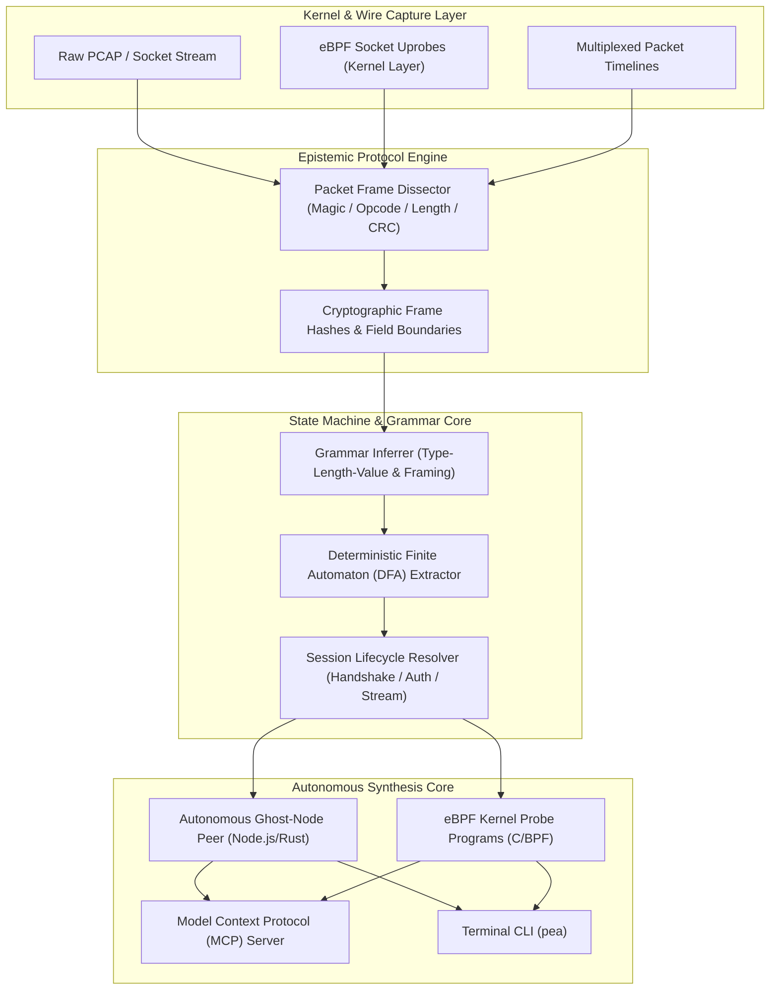

# PEA — Protocol & Distributed Systems Anything 🌐⚡

> **Autonomous Binary Wire-Protocol Deconstruction, eBPF State-Machine Inference, and Distributed Ghost-Node Synthesis Engine.**

PEA is an industrial-grade distributed systems and protocol engineering workbench. It ingests raw packet captures, socket streams, and eBPF traces, automatically derives **binary framing grammars and protocol state machines**, and synthesizes **autonomous ghost-node peers** that can speak undocumented protocols natively.

---

## ⚡ Architecture



---

## 🚀 Key Capabilities

- **Binary Wire-Protocol Dissection**: Automatically detects framing patterns:
  - Magic byte headers (e.g. `0xCAFE`, `0x55AA`).
  - Big-endian vs Little-endian length prefixes.
  - Opcode command fields and payload boundaries.
  - Trailing CRC32 / Checksums.
- **DFA State Machine Inference**: Maps multi-turn packet exchanges into deterministic finite automata (Handshake $\rightarrow$ Authenticated $\rightarrow$ Heartbeat / Sync $\rightarrow$ Teardown).
- **Autonomous Ghost-Node Synthesis**: Generates a complete, standalone peer node script that implements the exact framing and state transitions to participate in the network cluster.
- **eBPF Socket Probe Generation**: Synthesizes Linux eBPF kernel C code to inspect raw application socket buffers at the system-call boundary before TLS encryption.
- **Model Context Protocol (MCP) Integration**: Plugs directly into AI coding agents, giving them deep-packet network engineering superpowers.

---

## 🛠️ CLI Usage

### 1. Dissect Binary Packet Stream
```bash
npx pea dissect packets.hex --magic 0xCAFE
```

### 2. Infer Protocol State Machine
```bash
npx pea state-machine session_capture.json --output ./state_graph.json
```

### 3. Synthesize Ghost-Node Peer
```bash
npx pea ghost session_capture.json --name ClusterPeer -o peer.mjs
```

### 4. Run MCP Server
```bash
npx pea mcp
```

---

## 🤖 MCP Tools for AI Agents

| Tool | Description |
|---|---|
| `dissect_binary_packets` | Parses raw binary packet bytes and infers frame headers, opcodes, and length fields. |
| `infer_protocol_state_machine` | Reconstructs the multi-state protocol automaton from timestamped packet exchanges. |
| `generate_ghost_node` | Emits a runnable Node.js network client implementing the protocol state machine. |
| `generate_ebpf_socket_probe` | Generates C eBPF kernel probes for tracing socket reads and writes. |

---

## 📄 License
Apache-2.0
